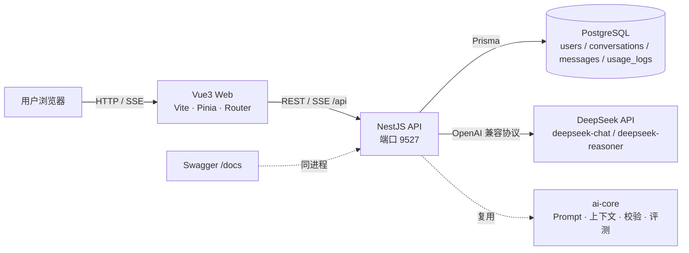
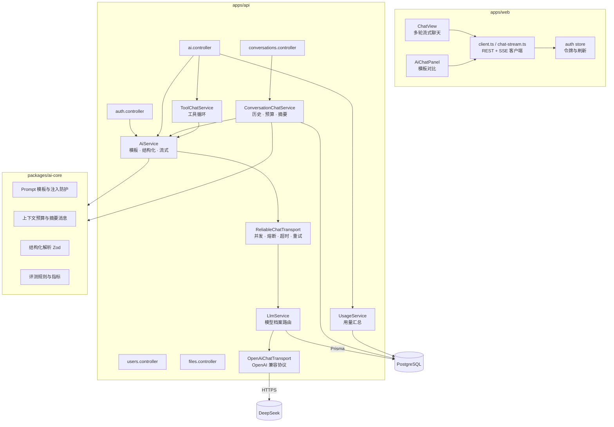
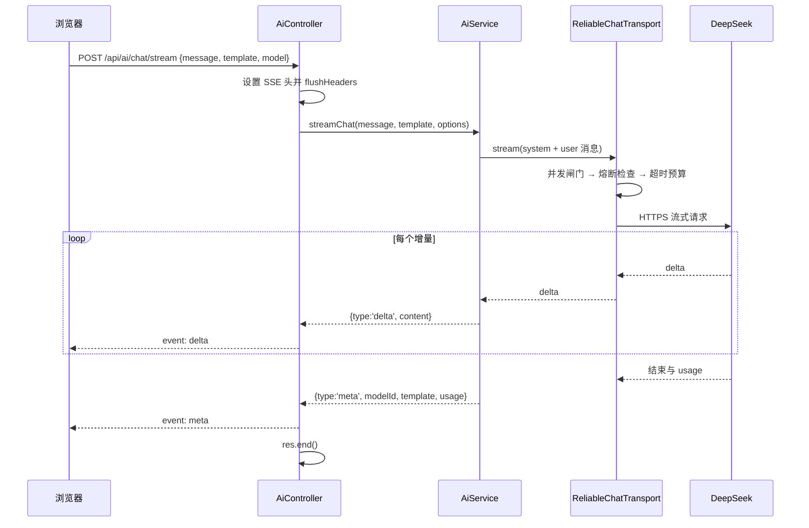
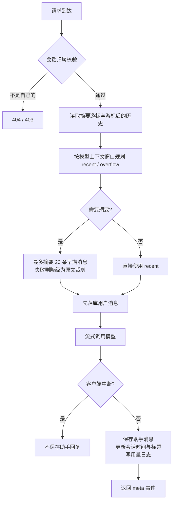
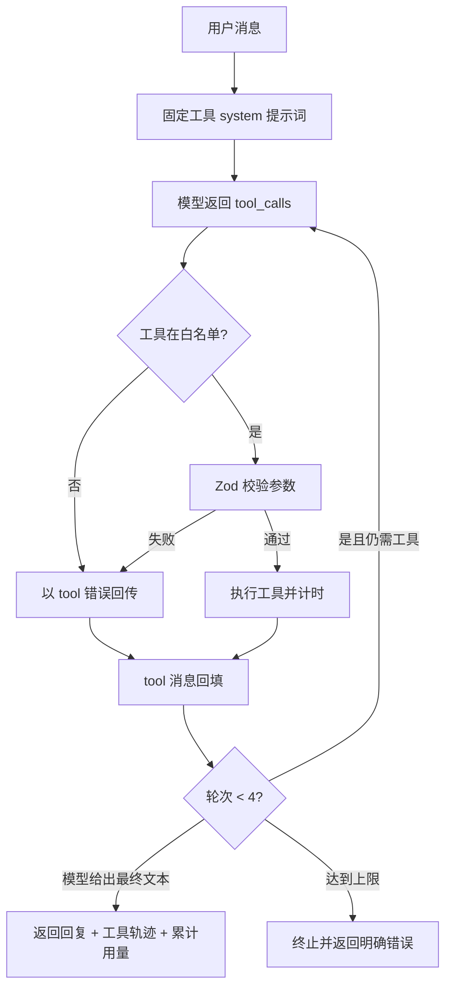
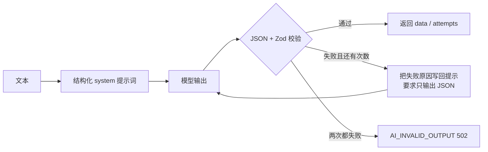
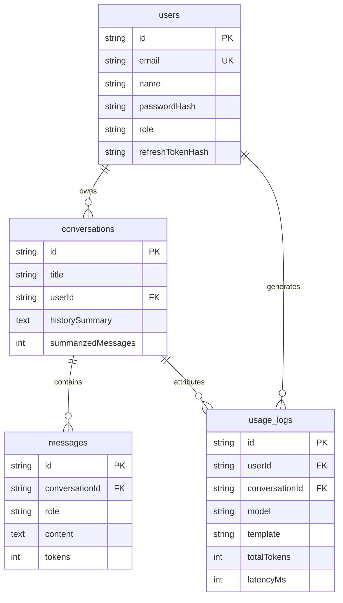
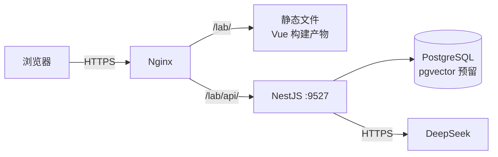

# AI Chat v1.0 架构

> 版本：1.0.0　发布日期：2026-11-21
>
> 范围：从浏览器到模型供应商的完整链路，包括鉴权、会话、流式输出、上下文管理、结构化输出、工具调用、可靠性层与评测。RAG 与 Agent 不在本版本内。

## 一、系统上下文



关键边界：

- **浏览器不接触模型密钥**，也不提交 system 提示词；模型档案、Prompt 模板与工具白名单全部由服务端决定。
- **API 与 ai-core 是包依赖关系**，不是网络调用；ai-core 是无 I/O 的 CommonJS 纯函数库，可被测试直接断言。
- **PostgreSQL 是唯一持久化存储**，会话、消息与用量都以数据库为准，前端状态只是投影。

## 二、应用分层



## 三、模块职责

| 层 | 模块 | 职责 | 不做什么 |
| --- | --- | --- | --- |
| Web | `ChatView` | 会话列表、历史消息、流式渲染、停止生成、模型切换、用量展示 | 不拼 userId，不直接访问数据库语义 |
| Web | `chat-stream.ts` | 解析 SSE、处理跨块字符、401 自动刷新一次 | 不解释业务错误，只上报 code/message |
| API | `AiController` | 单轮对话、SSE、结构化、工具、模型目录、用量 | 不实现 Prompt 细节 |
| API | `ConversationsController` | 会话与消息 CRUD、多轮流式 | 不做模型调用编排 |
| API | `AiService` | 模板选择、结构化重试、错误映射、流式事件 | 不管理会话归属 |
| API | `ConversationChatService` | 归属校验、历史加载、上下文预算、摘要、落库 | 不直接拼模型 HTTP 请求 |
| API | `ToolChatService` | 工具循环、轨迹记录、轮次上限 | 不实现具体工具 |
| API | `ReliableChatTransport` | 并发闸门、熔断、超时、有限重试 | 不改变业务响应结构 |
| API | `LlmService` | 按公开档案 ID 选择模型与密钥 | 不暴露地址与密钥给客户端 |
| Core | `prompts` | 模板注册表、输入包裹、注入防护 | 不读取环境变量 |
| Core | `context` | Token 估算、recent/overflow 规划、摘要消息 | 不访问数据库 |
| Core | `structured` | Zod schema 与解析失败原因 | 不决定重试策略 |
| Core | `evals` | 固定测试集、规则校验、指标统计 | 不发网络请求（脚本层才调用模型） |

## 四、关键链路

### 4.1 单轮流式对话 `POST /api/ai/chat/stream`



约束：

- 响应头一旦发出，HTTP 状态码固定为 200，后续错误只能通过 `event: error` 下发。
- 客户端断开时 `req.close` 触发 `AbortController`，上游请求被取消，避免继续计费。
- 如果模型没有产出任何内容，抛出 `AI_EMPTY_RESPONSE`，避免前端显示空白回答。

### 4.2 多轮流式与上下文记忆 `POST /api/conversations/:id/messages/stream`



设计取舍：

- **先保存用户消息**：模型失败或用户中断时，至少保留用户输入，刷新页面不会“说过的话消失”。
- **中断不保存助手回复**：半截回答进入历史会污染下一轮上下文。
- **摘要持久化**：`historySummary` 与 `summarizedMessages` 存在会话表，避免每轮重复压缩。
- **预算来自模型档案**：上下文窗口由所选模型决定，不是全局常量。

### 4.3 工具调用 `POST /api/ai/tools/chat`



- 工具白名单：`get_current_time`、`calculator`，模型无法调用未登记工具。
- 每一轮都会产生 Token，用量按轮累加后写入 `usage_logs`。
- `toolRuns` 记录工具名、参数、结果、耗时，便于复盘模型是否选对工具。

### 4.4 结构化输出 `POST /api/ai/classify`、`POST /api/ai/extract`



失败原因只保留稳定描述（空内容 / 非 JSON / 字段不符），不回显模型原文，避免把内部提示词或敏感内容带进日志。

### 4.5 可靠性层

```text
业务层
  ↓ 只认识 ChatTransport
ReliableChatTransport
  ├─ 并发信号量：最多 4 个在途，排队 5 秒
  ├─ 熔断器：连续 5 次失败后冷却 30 秒
  ├─ 每次尝试独立超时：30 秒
  └─ 指数退避重试：最多 3 次，200ms 起，2s 上限，带抖动
  ↓
LlmService（模型档案路由）
  ↓
OpenAiChatTransport（OpenAI 兼容协议）
```

只有可重试错误才进入重试：超时、网络中断、429、5xx、空回复。配置错误、未知模型、401/403、400 直接失败，避免重复计费。

## 五、数据模型



不使用数据库存模型密钥、Prompt 原文或供应商响应；用量日志只记录元数据，不复制消息内容。

## 六、部署拓扑



开发环境由 Vite 代理 `/api` 到 `localhost:9527`；生产环境由 Nginx 统一入口并注入子路径。密钥只存在于服务端环境变量。

## 七、关键决策记录

| 决策 | 选项 | 结论 | 代价 |
| --- | --- | --- | --- |
| Prompt 归属 | 前端提交提示词 / 服务端模板 | 服务端模板 ID | 新增模板要发版，但客户端无法注入 system |
| 流式协议 | WebSocket / SSE | SSE | 只能服务端单向推送，但实现简单、可穿透代理 |
| 模型切换 | 客户端传真实模型名 / 公开档案 ID | 档案 ID | 多一层映射，但地址与密钥不外泄 |
| 上下文策略 | 全量历史 / 最近 N 条 + 摘要 | 预算内 recent + 增量摘要 | 摘要会丢细节，需保留摘要游标 |
| 可靠性 | 业务层各自重试 / 统一包装层 | 包装 `ChatTransport` | 多一层间接，但所有调用方自动受益 |
| 评测评分 | 裁判模型 / 确定性规则 | 确定性规则 | 无法判断语义质量，但结果可复现、零额外成本 |
