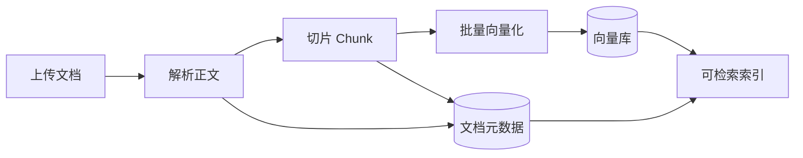
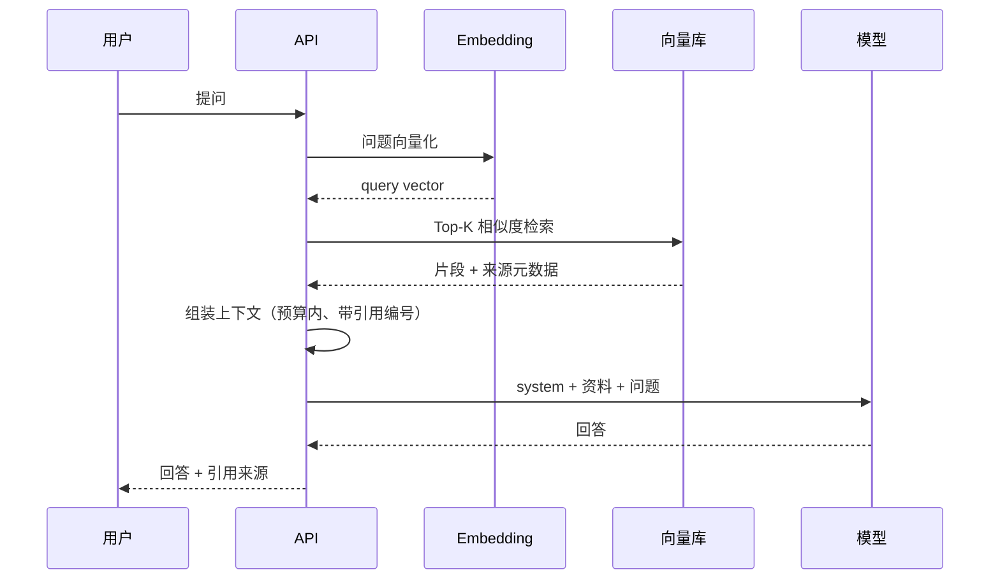
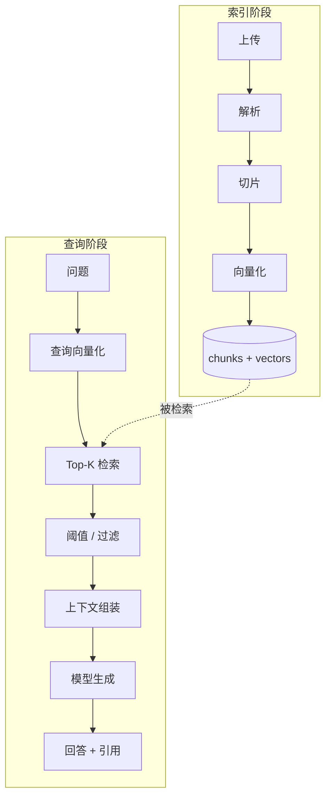

# Week 5 Day 1：RAG 全链路

> 目标：先画清楚「文档如何进入知识库、问题如何变成回答」两条链路，再决定每一段用什么技术。今天不写 RAG 业务代码，只产出可评审的链路图、阶段契约和边界说明，作为 Day 2～6 的实现依据。

## 一、RAG 解决什么问题

模型参数里没有企业私有资料，直接提问会出现三种问题：

1. **不知道**：模型没见过内部文档，只能编造。
2. **过时**：训练数据有截止时间，最新制度、价格、工单都不在参数里。
3. **不可追溯**：即使答对，也无法说明依据来自哪份文档的哪一段。

RAG（Retrieval-Augmented Generation，检索增强生成）的做法是：**先从资料库检索相关片段，再把片段放进提示词，让模型基于片段回答**。

它不解决的问题：

- 不是训练，不会改变模型参数；
- 不会自动保证答案正确，检索错了，生成只会「一本正经地错」；
- 不负责文档质量，脏数据进去，脏答案出来。

## 二、两条链路

RAG 常被当成一个接口，实际上是两条独立链路，失败时要能分别定位。

### 2.1 索引阶段（离线 / 写入）



特点：

- 运行频率低，但单次可能很重（大 PDF、批量导入）；
- 允许异步、排队、失败重试；
- 产物要可重建：同一份文档重复导入，不应产生无法清理的脏数据。

### 2.2 查询阶段（在线 / 读取）



特点：

- 延迟敏感，通常要求在秒级完成；
- 检索与生成是两次独立失败点；
- 必须保留「命中了哪些片段」的证据，否则无法排查答非所问。

### 2.3 全链路



两条链路共享同一份 **chunk 契约**：索引阶段写入什么字段，查询阶段就必须能读到什么字段。契约不稳定，后面换切片策略或换向量库都会牵连整条链路。

## 三、阶段契约

| # | 阶段 | 输入 | 输出 | 典型失败 | 本阶段不负责 |
| --- | --- | --- | --- | --- | --- |
| 1 | 上传 | 文件、用户身份 | 文档记录、存储路径 | 类型不支持、超过大小、重复上传 | 解析内容 |
| 2 | 解析 | 文件字节 | 正文 + 页码/标题/段落 | 扫描 PDF 无文本、编码错误、格式损坏 | 切片、向量化 |
| 3 | 切片 | 正文 + 结构信息 | chunk 列表（文本、序号、来源） | 切断表格/代码、块过大或过小 | 判断相关性 |
| 4 | 向量化 | chunk 文本 | 向量 + 模型标识 + 维度 | 限流、超时、批次部分失败 | 存储与检索 |
| 5 | 入库 | chunk + 向量 + 元数据 | 可检索记录 | 维度不一致、事务部分成功 | 生成回答 |
| 6 | 查询向量化 | 用户问题 | query vector | 问题过长、空问题 | 改写问题（Week 6） |
| 7 | 检索 | query vector、Top-K、过滤条件 | 命中片段 + 分数 | 召回为空、相似度普遍偏低 | 总结与回答 |
| 8 | 上下文组装 | 命中片段、Token 预算 | 带引用编号的上下文 | 超预算、片段重复、顺序混乱 | 判断答案对错 |
| 9 | 生成 | 上下文 + 问题 + 约束 | 回答 + 引用 | 幻觉、超时、拒答不当 | 重新检索（除非显式设计） |

这份表是后续实现的检查清单：每个阶段都要能回答「输入什么、输出什么、失败怎么表现」。

## 四、召回与生成的边界

RAG 最常见的错误，是把「检索没找到」和「模型不会答」混为一谈。

### 4.1 职责边界

| 问题 | 应由谁负责 | 判断依据 |
| --- | --- | --- |
| 资料里有没有相关内容？ | 检索 | 命中片段与分数 |
| 命中的片段是否真的相关？ | 检索 + 阈值 / 重排 | 相似度、关键词、人工标注 |
| 片段之间是否矛盾？ | 生成（或人工） | 回答中的取舍与说明 |
| 回答是否忠于片段？ | 生成 + 引用校验 | 每句结论能否对应到片段 |
| 资料里没有答案时怎么办？ | 生成（受 Prompt 约束） | 明确拒答，而不是编造 |

### 4.2 三个典型例子

| 输入 | 检索结果 | 正确行为 | 错误行为 |
| --- | --- | --- | --- |
| 「报销标准是多少？」 | 命中《差旅制度》第 3 节 | 基于片段回答并引用 | 用模型常识编一个数字 |
| 「公司食堂今天吃什么？」 | 无命中或分数很低 | 明确说资料中没有 | 编造菜单 |
| 「把差旅制度总结成三条」 | 命中多段制度 | 只基于命中片段总结 | 自行补充未检索到的条款 |

结论：

- **检索为空或低于阈值时，生成必须拒答**，不能靠模型「猜」；
- **回答必须带引用**，否则无法验证忠实度；
- **检索质量与生成质量要分开评估**：召回率、命中率是一组指标，忠实度、相关性是另一组指标（Week 6 Day 5）。

## 五、失败模式与观测点

| 现象 | 可能原因 | 观测点 |
| --- | --- | --- |
| 答非所问 | 切片粒度不对、Top-K 太小、问题与文档用词差异大 | 命中片段、相似度分数、chunk 长度 |
| 回答缺条款 | 切片切断上下文、解析漏页 | chunk 边界、来源页码、解析字符数 |
| 引用对不上 | chunk ID 不稳定、组装时顺序错乱 | chunk ID、引用编号映射 |
| 回答编造 | Prompt 未约束、上下文超预算被截断 | 实际送入模型的上下文、Token 数 |
| 延迟高 | 检索范围过大、Top-K 太大、生成过长 | 检索耗时、生成耗时、上下文 Token |
| 重复导入脏数据 | 缺少文档去重与幂等键 | 文档哈希、chunk 唯一键 |

本周实现时，至少记录：**解析耗时、chunk 数、向量化批次数、检索耗时、Top-K、上下文 Token、生成耗时**。

## 六、本周落地计划

| 天 | 任务 | 与本图对应 |
| --- | --- | --- |
| Day 2 | 文档解析：PDF / DOCX / TXT / Markdown | 阶段 2 |
| Day 3 | Recursive / Markdown 切片 | 阶段 3 |
| Day 4 | Embedding API 与批量向量化 | 阶段 4 |
| Day 5 | pgvector 建表与 Top-K 检索 | 阶段 5、7 |
| Day 6 | ingestion pipeline 验收 | 阶段 1～5 串起来 |

查询阶段的 6、8、9 在 Week 6 完成；本周只做「能入库、能检索、能调试」。

## 七、接口与数据模型草案

> 以下是 Week 5～6 的目标形态，本日不实现，先固定命名，避免每天各起一套。

### 7.1 接口

| 方法 | 路径 | 用途 | 计划 |
| --- | --- | --- | --- |
| POST | `/api/knowledge/documents` | 上传文档并创建处理任务 | Day 6 |
| GET | `/api/knowledge/documents` | 文档列表与状态 | Day 6 |
| DELETE | `/api/knowledge/documents/:id` | 删除文档及其 chunks | Day 6 |
| POST | `/api/knowledge/search` | 检索调试：返回片段与分数 | Day 5 |
| POST | `/api/knowledge/ask` | 检索 + 生成 + 引用 | Week 6 |

### 7.2 表

```text
documents
  id, user_id, filename, mime_type, size, status,
  chunk_count, content_hash, created_at, updated_at

document_chunks
  id, document_id, chunk_index, content,
  page, section, token_count, embedding vector(维度),
  created_at
```

关键约束：

- `content_hash` 用于识别重复上传；
- `(document_id, chunk_index)` 唯一，重复处理可覆盖而不是追加；
- chunk 保存原文与来源信息，向量只是检索用的派生数据；
- 换 Embedding 模型时必须整库重算，因此要记录模型名与维度。

## 八、设计取舍

| 问题 | 选项 | 本阶段结论 | 原因 |
| --- | --- | --- | --- |
| 索引同步还是异步 | 上传即处理 / 后台任务 | 先同步，Day 6 视耗时再改异步 | 数据量小，先保证链路可跑通 |
| 切片粒度 | 固定字符 / 按结构 / 递归 | Day 3 实现递归 + Markdown 结构切片 | 兼顾语义完整与实现成本 |
| 向量存哪 | 内存 / pgvector / 专用向量库 | pgvector | 已有 PostgreSQL，事务与过滤更简单 |
| 距离度量 | 余弦 / 内积 / 欧氏 | 余弦距离 | 文本 Embedding 常用且对长度不敏感 |
| 是否重排 | 先不重排 / 一开始就加 | Week 6 再加 | 先拿到基础召回指标，再判断是否值得 |
| 回答无依据时 | 让模型自由发挥 / 强制拒答 | 强制拒答并提示「资料未覆盖」 | 宁可少答，不可编造 |

## 九、自测题

1. 索引阶段和查询阶段分别什么时候运行？为什么不能合成一个接口？
2. 检索为空时，应该由检索层还是生成层决定「不回答」？
3. 为什么 chunk 要保存原文和来源，而不是只存向量？
4. 换 Embedding 模型后，为什么必须重建索引？
5. 如果回答答非所问，应该先检查哪几个观测点？

### 参考答案

1. 索引在文档上传/更新时运行，查询在用户提问时运行。两者频率、延迟要求、失败处理都不同；合成一个接口会让上传阻塞在线请求，也无法单独重试。
2. 检索层负责给出「有没有命中、分数多少」，生成层在 Prompt 约束下执行拒答。阈值策略属于检索，拒答表达属于生成。
3. 向量不可逆，无法还原文本；引用、调试、重新切片、换模型都需要原文与来源元数据。向量只是索引，不是数据本身。
4. 不同模型的向量空间不可比较，维度与语义都可能不同；混用会导致相似度失真，必须整库重算。
5. 先看命中了哪些片段与相似度分数，再看切片边界是否完整，最后检查实际送入模型的上下文是否被截断或顺序错乱。

## 十、今日三行

- 今天解决了什么问题：画出 RAG 的索引与查询两条链路，固定 9 个阶段的输入输出、失败模式与职责边界。
- 为什么这样设计：先定契约再写代码，避免 Day 2～6 每天各起一套字段；把检索错误与生成错误分开，后续评估才能定位。
- 还有什么不确定：切片粒度与 Top-K 的最优值、是否需要重排、同步处理能支撑多大的文档，需要等 Day 3～5 有真实数据后再定。
