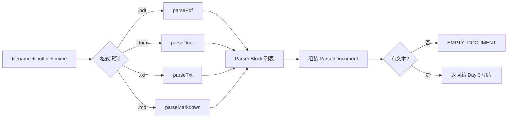

# Week 5 Day 2：文档解析

> 目标：把 PDF / DOCX / TXT / Markdown 变成统一的 `ParsedDocument`，保留标题、页码、段落与标题路径，为 Day 3 切片提供稳定输入。
>
> 产物：新增 `packages/rag`，实现 `parseDocument` 与 8 项离线测试。

## 一、为什么解析是 RAG 的第一道质量关

切片、向量化、检索都建立在解析结果上。解析阶段丢掉的标题或页码，后面任何一步都补不回来：

- 标题丢了 → 切片不知道自己在哪一章，检索结果缺少语义边界；
- 页码丢了 → 回答无法引用「第 3 页」，用户无法核对；
- 段落乱了 → 切片可能把两个主题拼在一起，向量表示被污染；
- 表格被拆散 → 数值和表头分离，模型只能猜。

所以解析器的目标不是「把文件读成字符串」，而是**尽量保留原文结构**。

## 二、四种格式的差异

| 格式 | 结构来源 | 页码 | 主要难点 | 本实现策略 |
| --- | --- | --- | --- | --- |
| PDF | 版式（坐标、字体大小） | 有，按页 | 没有语义标签；页眉页脚混入正文；扫描件没有文本层 | 逐页提取文本，按行间距离推断段落 |
| DOCX | OOXML 样式（Heading 1/2） | 无 | 分页由排版决定，文件里没有固定页码 | Mammoth 转 HTML，再提取标题与段落 |
| TXT | 几乎没有 | 无 | 编码不确定（UTF-8 / GB18030）、没有标题 | 检测 BOM 与替换字符，按空行分段 |
| Markdown | 显式语法（`#`、列表、代码块） | 无 | 代码块里的 `#` 不是标题；表格需要整段保留 | 逐行状态机，先处理代码围栏 |

一个关键认知：**DOCX 没有页码**。页码是 Word 排版时算出来的，不是文件内容的一部分。因此统一模型里 `page` 允许为 `null`，不能为了字段整齐而编造页码。

## 三、统一模型

实现位置：[types.ts](file:///d:/StudyAI/ai-fullstack-lab/packages/rag/src/types.ts)

```ts
interface ParsedBlock {
  index: number;                 // 文档内顺序
  type: 'heading' | 'paragraph' | 'list' | 'table' | 'code';
  text: string;                  // 已去掉 Markdown / HTML 标记
  page: number | null;           // PDF 页码，从 1 开始
  headingLevel: number | null;   // 1~6，仅标题块
  sectionPath: string[];         // ["差旅制度", "住宿标准"]
  charCount: number;
}

interface ParsedDocument {
  format: 'pdf' | 'docx' | 'txt' | 'markdown';
  filename: string;
  title: string;
  mimeType: string;
  text: string;
  blocks: ParsedBlock[];
  pageCount: number | null;
  blockCount: number;
  charCount: number;
  metadata: Record<string, string>;
  warnings: string[];
}
```

为什么 `sectionPath` 要复制到每个块，而不是只存一份标题树：

- 切片器按块遍历时，不需要再维护一套标题栈；
- 一个块被单独取出做检索或引用时，来源信息是自包含的；
- 代价是重复字符串，但标题都很短，换来的是调用方更简单。

## 四、实现结构



| 文件 | 职责 |
| --- | --- |
| [parse-document.ts](file:///d:/StudyAI/ai-fullstack-lab/packages/rag/src/parse-document.ts) | 格式识别、调用解析器、空文档校验、错误包装 |
| [parsers.ts](file:///d:/StudyAI/ai-fullstack-lab/packages/rag/src/parsers.ts) | 四种格式的具体解析 |
| [text.ts](file:///d:/StudyAI/ai-fullstack-lab/packages/rag/src/text.ts) | 编码检测、换行归一化、块构造 |
| [errors.ts](file:///d:/StudyAI/ai-fullstack-lab/packages/rag/src/errors.ts) | `UNSUPPORTED_FORMAT` / `EMPTY_DOCUMENT` / `PARSE_FAILED` |

格式识别顺序：先看扩展名，扩展名不认识再看 MIME，两者都不认识才报错。这样既兼容 `handbook.md`，也兼容浏览器上传时丢失扩展名但带 `text/markdown` 的情况。

## 五、各格式的实现细节

### 5.1 PDF：按页提取，按行距分段

`pdf-parse` 允许自定义 `pagerender`。实现里逐页读取文本项，利用 `transform[5]`（纵坐标）判断换行：

```ts
if (Math.abs(y - lastY) <= 1) {
  pageText += item.str;               // 同一行
} else if (Math.abs(y - lastY) > 14) {
  pageText += '\n\n' + item.str;      // 行距明显变大，视为段落
} else {
  pageText += '\n' + item.str;        // 普通换行
}
```

注意这是**启发式**：PDF 没有段落概念，只能靠间距猜。它能处理常见正文，但页眉页脚、双栏排版、表格仍可能出错。页码来自 PDF 页对象本身，因此是可靠的。

### 5.2 DOCX：Mammoth 转 HTML，再按标记提取

Mammoth 会把 Word 的 Heading 样式映射成 `<h1>`、`<h2>`，把段落映射成 `<p>`，把列表映射成 `<li>`。实现先把这些标签替换成 `@@H1@@`、`@@P@@`、`@@LI@@` 标记，去掉其余标签，再逐行解析：

- 遇到 `@@H1@@` 就更新标题栈；
- 段落与列表继承当前 `sectionPath`；
- Mammoth 的消息作为 `warnings` 返回，不中断解析。

为什么不直接 `extractRawText`：那样会丢掉标题层级，所有内容变成一整段纯文本，切片时无法按章节切。

### 5.3 Markdown：状态机 + 代码围栏优先

逐行扫描时，**先判断代码围栏**，避免把代码里的 `# 注释` 当成标题。其余状态：

- 标题：更新标题栈，块本身记录父路径；
- 列表：连续列表项合成一个 `list` 块；
- 表格：连续 `|` 行合成一个 `table` 块，过滤 `| --- |` 分隔行；
- 段落：连续非空行合成一个块；
- 代码块：保留内容，类型为 `code`。

### 5.4 TXT：编码比结构更难

TXT 的结构只有空行，真正的坑是编码：

1. 有 UTF-8 BOM 时先去掉 BOM；
2. 按 UTF-8 解码，若出现替换字符 `\uFFFD`，尝试 GB18030；
3. 运行环境不支持 GB18030 时保留 UTF-8 结果。

GB18030 回退依赖 Node 的 ICU 支持；在完整 ICU 构建下可用，精简构建可能失败，此时不会抛错，但正文会有替换字符。这个取舍优先保证「能解析」，而不是「编码不确定就拒绝」。

## 六、标题、元数据与错误

标题优先级：

1. 文档内标题（Markdown 一级标题、DOCX 一级标题、PDF `Info.Title`）；
2. 文件名去掉扩展名。

错误分三类，调用方不需要解析底层库文案：

| code | 触发条件 | 上层建议 |
| --- | --- | --- |
| `UNSUPPORTED_FORMAT` | 扩展名与 MIME 都不支持 | 返回 400，提示支持格式 |
| `EMPTY_DOCUMENT` | 文件为空，或解析后无有效文本 | 返回 422，提示重新上传 |
| `PARSE_FAILED` | 文件损坏、加密、底层异常 | 返回 422，记录 `details` 供排查 |

空文档必须报错而不是返回空数组：如果继续入库，会产生一个永远检索不到的文档，用户却以为上传成功。

## 七、使用方式

```ts
import { parseDocument, DocumentParseError } from '@ai-lab/rag';

try {
  const doc = await parseDocument({
    filename: '差旅制度.pdf',
    mimeType: 'application/pdf',
    buffer: fileBuffer,
  });

  console.log(doc.title);       // 差旅制度
  console.log(doc.blockCount);  // 42
  console.log(doc.pageCount);   // 8
  console.log(doc.blocks[0]);   // { page: 1, sectionPath: [...], ... }
} catch (error) {
  if (error instanceof DocumentParseError) {
    console.error(error.code, error.message);
  }
}
```

API 接入放在 Day 6 的 ingestion pipeline，本日不新增 HTTP 接口。

## 八、测试

测试文件：[parser.test.cjs](file:///d:/StudyAI/ai-fullstack-lab/packages/rag/tests/parser.test.cjs)

夹具不提交二进制，测试运行时在内存里生成：

- DOCX 用 JSZip 拼最小 OOXML；
- PDF 用 pdf-lib 画两页文本；
- TXT / Markdown 直接构造 Buffer。

| 用例 | 验证点 |
| --- | --- |
| TXT BOM | 去 BOM、按空行分段、标题回退文件名 |
| TXT 空文件 | 返回 `EMPTY_DOCUMENT` |
| Markdown | 标题层级、标题路径、列表、表格、代码块 |
| MIME 兜底 | 文件名为 `upload` 时按 `text/markdown` 解析 |
| DOCX | Heading 1/2、段落继承标题路径 |
| PDF | 两页正文、页码 1/2、`Info.Title` |
| 不支持格式 | CSV 返回 `UNSUPPORTED_FORMAT` |
| 损坏 PDF | 返回 `PARSE_FAILED` |

### 踩坑：PDF 夹具与旧版 pdf.js

最初用 pdfkit 生成测试 PDF，`pdf-parse` 报 `bad XRef entry`。原因是 pdfkit 的输出与 pdf-parse 内置的旧版 pdf.js 不兼容。改用 pdf-lib 生成标准 xref 后通过。

这个坑本身说明了一件事：**解析库的兼容性要在真实文件上验证**，不能假设「都是 PDF 就都能读」。生产环境也要准备多来源样本，而不是只测自己生成的文件。

## 九、验证结果

| 检查 | 结果 |
| --- | --- |
| `@ai-lab/rag` 测试 | 8/8 通过 |
| `@ai-lab/ai-core` 测试 | 64/64 通过 |
| `@ai-lab/api` 测试 | 62/62 通过 |
| 全仓库 lint | 0 error（64 个前端模板 warning） |
| 全仓库 typecheck | 4 个包全部通过 |
| 全仓库 build | 4 个包全部通过 |

补充：`ai-core` 的 Prompt 版本一致性测试在 Windows 检出后会遇到 CRLF 差异，已在测试内统一换行符，这是跨平台测试的修复，不改变生产模板。

## 十、已知限制

- **扫描版 PDF 不在支持范围**：没有文本层时解析结果为空，需要 OCR，本阶段不做。
- **PDF 段落是启发式**：页眉页脚、双栏、复杂表格可能被错误合并或拆分。
- **DOCX 没有页码**：统一模型返回 `page: null`；引用只能到标题路径，不能到页。
- **DOCX 表格被拆成段落**：当前保留文字，但丢失表头与单元格关系。
- **TXT 无空行时只有一个块**：没有结构信息，无法可靠分段。
- **库层不做大小与页数限制**：5MB 限制在 API 层（Day 6）执行；超大 PDF 仍可能占用较多内存。
- **`pdf-parse` 版本较旧**：对部分新 PDF 特性兼容有限；换库需要重新跑多来源样本。
- **`charCount` 按 UTF-16 长度统计**：中文场景与字符数接近，但 emoji 等字符会按 2 计。
- **GB18030 回退依赖 ICU**：精简 Node 构建下可能无法正确解码。

## 十一、自测题

1. 为什么 PDF 的页码可靠，但段落边界不可靠？
2. DOCX 为什么没有页码？统一模型应该怎么表达？
3. 为什么每个块都要保存 `sectionPath`，而不是只在文档级保存标题树？
4. 解析结果为空时，为什么必须抛错而不是返回空块列表？
5. 扫描版 PDF 面试题：解析返回空文本，应该先怀疑什么？怎么处理？

### 参考答案

1. 页码来自 PDF 的页对象，是文件结构的一部分；段落只是视觉排版，没有语义标记，只能根据坐标与行距推断，所以必然有误差。
2. DOCX 只存内容与样式，分页由打开文档的软件按纸张和字体计算，文件里没有固定页码。统一模型用 `page: null` 表示「该格式没有页码」，不能编造。
3. 切片器按块处理，块被单独检索、引用或重排时，必须自带来源上下文；否则调用方还要回查标题树，接口更复杂，也更容易错。
4. 空结果继续入库会产生「上传成功但永远检索不到」的脏数据；抛错能让用户立即重传或换格式，也便于统计解析失败率。
5. 先怀疑没有文本层（扫描件），而不是编码问题：检查解析字符数是否为 0、PDF 是否包含图片页。处理方式是引入 OCR 或要求用户上传可复制文本的 PDF；在没有 OCR 前，明确提示不支持。

## 十二、今日三行

- 今天解决了什么问题：新增 `packages/rag`，把 PDF / DOCX / TXT / Markdown 统一成带页码、标题层级与标题路径的块模型，并补齐 8 项离线测试。
- 为什么这样设计：解析只负责「忠实提取」，不掺入切片与检索判断；来源信息随块走，后续引用与调试不需要回查原文件。
- 还有什么不确定：PDF 段落启发式在复杂版式上的准确率、扫描件的处理策略、DOCX 表格是否值得保留结构，需要等真实文档样本再评估。
