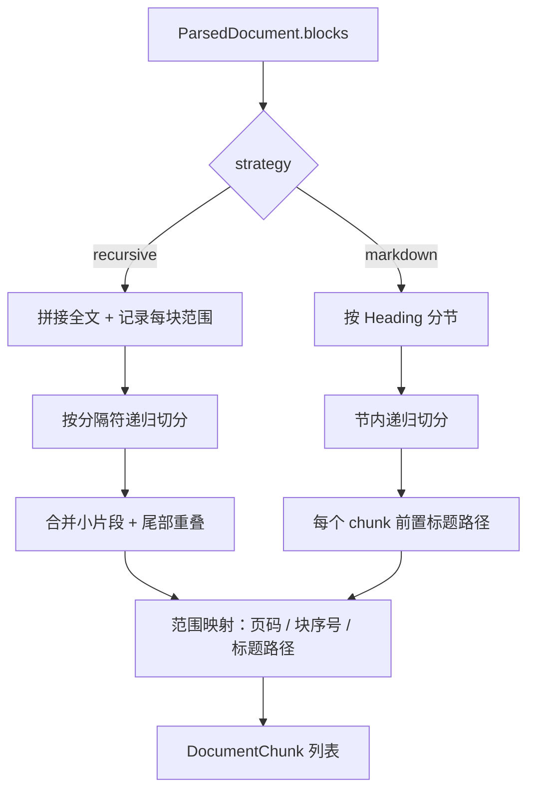

# Week 5 Day 3：Chunk 切片

> 目标：把解析后的块切成「适合向量化、又能独立表达语义」的 chunk，并保留序号、页码、标题路径与块来源。
>
> 产物：`chunkDocument` 支持 Recursive 与 Markdown 两种策略，新增 11 项离线测试。

## 一、为什么切片是最容易被低估的一步

切片决定了检索的最小单位。切错了，后面调 Embedding、换向量库、改 Prompt 都救不回来：

- **切得太碎**：一个结论被拆到两个 chunk，检索只命中半句，模型缺少前提；
- **切得太大**：一个 chunk 混了三个主题，向量被平均，什么都不像；
- **切断结构**：标题和正文分离，chunk 看起来像一段孤立的句子；
- **没有重叠**：关键句刚好落在边界，两边都只拿到半句；
- **丢来源**：命中后无法回答「出自哪一页、哪一节」，引用做不出来。

所以切片不是「按 500 字截断」，而是**在大小限制内尽量保住语义边界，并让每个 chunk 自带来源**。

## 二、四种基本策略

| 策略 | 做法 | 优点 | 缺点 | 适用 |
| --- | --- | --- | --- | --- |
| 固定长度 | 每 N 个字符切一刀 | 实现最简单、大小均匀 | 必然切断句子与段落 | 基线、无结构文本 |
| 递归切片 | 先按段落，再按行、句号、逗号，最后硬切 | 尽量保住语义边界 | 仍有启发式误差 | PDF、TXT、DOCX |
| 重叠窗口 | 相邻 chunk 共享尾部 N 字符 | 降低边界丢信息 | 存储与 Token 增加 | 所有策略的补充 |
| 按标题切片 | 以 Heading 为边界，再在节内递归 | chunk 主题单一、可带标题 | 依赖文档结构 | Markdown、DOCX |

本实现把「递归 + 重叠」作为通用策略，把「标题分节 + 节内递归 + 标题前缀」作为结构化策略。

## 三、粒度权衡

| 粒度 | 检索效果 | 生成效果 | 成本 |
| --- | --- | --- | --- |
| 过小（< 200 字符） | 关键词命中高，但语义不完整 | 模型缺少上下文，容易答一半 | chunk 数量多，Top-K 占满预算 |
| 适中（400～800 字符） | 一个主题基本完整 | 能独立回答局部问题 | 较平衡 |
| 过大（> 1200 字符） | 向量被多主题稀释 | 上下文浪费，重点被淹没 | Embedding 与生成费用上升 |

默认值取 **600 字符 / 80 字符重叠**，理由：

- 中文 600 字大约对应几百 Token，放进 Top-K 后仍能留出生成空间；
- 80 字符约 13% 重叠，足以覆盖一个被切断的句子，又不会大量重复；
- 这不是最优值，需要用 Week 6 的召回评估来校准，当前先保证行为可解释、可调整。

## 四、统一 chunk 模型

实现位置：[chunking/types.ts](file:///d:/StudyAI/ai-fullstack-lab/packages/rag/src/chunking/types.ts)

```ts
interface DocumentChunk {
  index: number;              // 文档内序号
  text: string;
  charCount: number;
  tokenCount: number;         // 估算值，不是分词器精确值
  page: number | null;        // 起始页
  pageEnd: number | null;     // 结束页，跨页时不同
  sectionPath: string[];      // ["差旅制度", "住宿标准"]
  blockIndexes: number[];     // 来源块，用于回溯原文
}
```

`blockIndexes` 是调试与引用的关键：检索命中后，可以顺着块序号回到解析结果，拿到原始页码与标题，而不需要重新解析文件。

## 五、整体流程



核心设计：**切片器返回原文上的 `[start, end)` 范围，而不是新字符串**。只有保留范围，才能准确映射来源；一旦提前 `slice` 成字符串，页码与块序号就只能靠猜。

## 六、Recursive 切片

实现位置：[split.ts](file:///d:/StudyAI/ai-fullstack-lab/packages/rag/src/chunking/split.ts)、[chunk.ts](file:///d:/StudyAI/ai-fullstack-lab/packages/rag/src/chunking/chunk.ts)

### 6.1 分隔符优先级

```text
段落 \n\n → 换行 \n → 。！？； → ， → 空格 → 硬切
```

从粗到细的原因：优先保住大结构。一个段落放得下，就不应该按句子拆；一句放得下，就不应该按逗号拆。只有所有自然边界都放不下时，才按字符硬切。

### 6.2 递归过程

1. 当前范围小于 `chunkSize`，直接作为一个片段；
2. 否则用当前分隔符切开，分隔符保留在前一段末尾，避免句子丢标点；
3. 仍然超大的片段，用下一级分隔符继续递归；
4. 所有分隔符都用完，按 `chunkSize` 硬切。

### 6.3 合并与重叠

递归只负责把小片段切到上限以内，真正形成 chunk 还需要合并：

```ts
if (fragment.end - current.start <= chunkSize) {
  current.end = fragment.end;          // 放得下就继续合并
} else {
  chunks.push(current);                // 放不下就封口
  const overlapStart = current.end - overlap;
  current = withOverlap <= chunkSize
    ? { start: overlapStart, end: fragment.end }
    : fragment;                        // 加了重叠会超限，就不加
}
```

这里有一个容易忽略的约束：**重叠不能导致 chunk 超过上限**。如果下一个片段本身就接近 `chunkSize`，再加重叠就会超限，此时宁可放弃重叠。测试里的硬切用例专门覆盖了这个分支。

## 七、Markdown 按标题切片

### 7.1 分节

遍历块，遇到 Heading 就开启新节：

- 节内保存正文块；
- 标题路径 = 父路径 + 当前标题，例如 `["差旅制度", "住宿标准"]`；
- 只有标题、没有正文的节直接跳过，避免产生「只有标题」的空 chunk；
- 第一个标题之前的内容作为前言节，路径为空。

### 7.2 每个 chunk 都带标题路径

节内仍然用递归切片，但每个 chunk 生成时会前置标题路径：

```text
差旅制度 > 住宿标准

一线城市每晚 600 元。其他城市每晚 400 元。
```

为什么每个 chunk 都加，而不是只加在第一节：

- 检索是按 chunk 独立的，模型看不到同节其它 chunk；
- 标题路径是最便宜的上下文，能让「600 元」明确是住宿标准，而不是餐补；
- 代价是重复 Token：同一节切成 5 块，标题就重复 5 次。

如果标题路径本身很长，正文预算会被压缩。实现里正文至少保留 50 字符，并在超出 `chunkSize` 时给出 warning，而不是静默截断。

## 八、Token 估算

实现位置：[tokens.ts](file:///d:/StudyAI/ai-fullstack-lab/packages/rag/src/chunking/tokens.ts)

| 内容 | 权重 |
| --- | --- |
| 中日韩字符 | 1 字符 ≈ 1 Token |
| 中文标点 | 1 个 ≈ 1 Token |
| 拉丁单词 | 1 词 ≈ 1.3 Token |
| 其它符号 | 1 个 ≈ 0.3 Token |

为什么不引入真正的 tokenizer：

- 不同模型分词器不同，会让 `rag` 包绑定具体模型；
- 当前只需要预算量级，误差 20% 以内足够判断是否超限；
- Day 4 调用 Embedding、Week 6 组装上下文时，可以用真实 `usage` 校准系数。

这是一个**估算**，不能用于计费对账。文档里明确写出来，避免后续误用。

## 九、参数与默认值

```ts
chunkDocument(document, {
  strategy: 'markdown', // 默认：md/docx 用 markdown，其它用 recursive
  chunkSize: 600,
  overlap: 80,
});
```

校验规则：

- `chunkSize` 必须是 >= 1 的整数；
- `overlap` 必须是 >= 0 且小于 `chunkSize` 的整数。

非法参数直接抛 `RangeError`，不静默修正。切片参数错了，后面所有指标都会失真，越早暴露越好。

## 十、测试

测试文件：[chunking.test.cjs](file:///d:/StudyAI/ai-fullstack-lab/packages/rag/tests/chunking.test.cjs)

| 用例 | 验证点 |
| --- | --- |
| 递归大小与来源 | 每个 chunk 不超上限，页码、块序号、标题路径正确 |
| 重叠窗口 | 第二个 chunk 保留第一个的尾部 |
| 无分隔符硬切 | 250 字符按 100/100/50 切开 |
| Markdown 标题前缀 | 每个 chunk 以标题路径开头，不跨节混内容 |
| 只有标题 | 返回空列表并给出警告 |
| 默认策略 | Markdown / DOCX 走 markdown，PDF 走 recursive |
| 参数校验 | 0、负数、`overlap >= chunkSize` 全部抛错 |
| Token 估算 | 中文、中文标点、英文、空文本 |
| 解析到切片 | Markdown 解析结果直接进入默认切片流程 |

## 十一、验证结果

| 检查 | 结果 |
| --- | --- |
| `@ai-lab/rag` 测试 | 19/19 通过（解析 8 + 切片 11） |
| `@ai-lab/ai-core` 测试 | 64/64 通过 |
| `@ai-lab/api` 测试 | 62/62 通过 |
| 全仓库 lint | 0 error（64 个前端模板 warning） |
| 全仓库 typecheck | 4 个包全部通过 |
| 全仓库 build | 4 个包全部通过 |

## 十二、已知限制

- **按字符而不是按 Token 切**：`chunkSize` 是字符数，Token 估算只是参考，不能保证模型侧不超限。
- **重叠可能从句中开始**：重叠是字符级尾部截取，不保证落在词或句子的边界。
- **Markdown 标题重复**：每个 chunk 都带标题路径，Token 成本随节内块数增加。
- **长标题路径会挤压正文**：路径超过 `chunkSize` 时正文按 50 字符保底，chunk 可能超出上限，只给 warning。
- **表格可能被拆行**：表格作为一个块参与递归，行数很多时仍可能在行之间切开。
- **只有标题的章节被丢弃**：不会生成「只有标题」的 chunk，但也会漏掉标题本身作为检索目标。
- **递归策略可能跨标题**：强制对 DOCX 使用 recursive 时，标题和正文可能被合进同一个 chunk；默认策略已避免这种情况。
- **没有语义切片**：不基于 Embedding 或模型判断主题边界，仍然是规则驱动。
- **尾块可能很短**：当前不做最小块合并，末尾可能留下几十字的 chunk。

## 十三、自测题

1. 为什么切片器要返回原文范围，而不是直接返回字符串？
2. 递归分隔符为什么从 `\n\n` 开始，而不是从字符开始？
3. 重叠窗口为什么会增加成本？什么情况下应该放弃重叠？
4. Markdown 切片为什么每个 chunk 都要加标题路径？代价是什么？
5. `chunkSize: 600` 是否等于 600 Token？评估召回时要注意什么？

### 参考答案

1. 范围保留了 chunk 在原文档中的位置，才能准确映射页码、块序号与标题路径；字符串一旦切出来，来源关系就丢了，引用和调试只能靠模糊匹配。
2. 先粗后细能优先保住段落与句子边界；如果先按字符切，会破坏所有自然边界，之后再合并也无法恢复。
3. 重叠会把同一段文字存进多个 chunk，Embedding 与生成都要重复付费，检索结果也可能重复。当新片段本身已接近上限、加重叠会超限时，应放弃重叠。
4. 每个 chunk 在检索时是独立的，标题路径能让它自带主题；代价是同一节的每个 chunk 都重复标题 Token，标题越长成本越高。
5. 不等于。600 是字符数，中文大约几百 Token，英文差异更大；评估召回时应同时看字符数与估算 Token，并用真实模型 usage 校准，不能把字符数当 Token 预算。

## 十四、今日三行

- 今天解决了什么问题：实现 Recursive 与 Markdown 两种切片，输出带序号、页码、标题路径、块来源与 Token 估算的 chunk，并补齐 10 项测试。
- 为什么这样设计：用原文范围做来源映射，避免切片后丢失出处；Markdown 每个 chunk 前置标题路径，让检索结果脱离上下文也能读懂。
- 还有什么不确定：600/80 是否适合当前语料、重叠是否值得、长表格与长标题路径怎么处理，需要 Week 6 用召回指标和真实文档验证。
